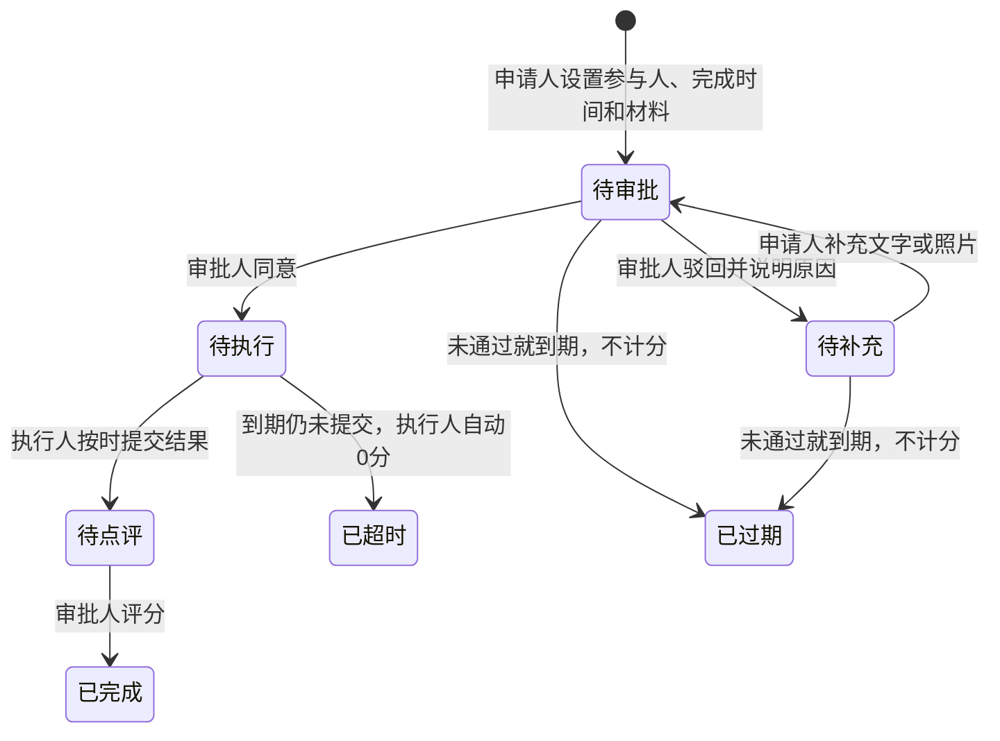

# 好友、执行人、完成时间与补充材料

## 身份和入口

微信登录自动建立自己的账号，并生成固定的 12 位好友编号。好友关系在小程序内由双方确认，通过编号查找或页面分享邀请发起；不使用全站用户列表充当好友列表。

“我的 → 我的好友”提供好友列表、申请、同意/拒绝/撤回、个人备注和删除。备注仅自己可见。未通过的申请不进入选人列表；删除好友后不能再新分派，但历史审批的参与人和权限保留。

申请人由登录身份确定，不能由请求参数冒充。执行人可选自己或已确认好友；审批人必须是申请人的好友，且与执行人不同。申请人不能兼任审批人，从而保证提交后申请人没有修改完成时间的权限。审批人同时负责最后评分。

## 流程和分数

可以替自己申请，也可以替好友申请。手工评分和超时 0 分都以每条任务为单位记入执行人账号，临时任务和每日任务都纳入统计；申请人不会因代办而获得执行人的分数。已按时提交、等待评分的任务不判超时。

首次创建必须设置未来的完成时间。之后只有审批人可在待审批、待补充、待执行时修改；原截止时间已过或结果已提交时不能修改。每次修改记录修改者、时间、修改前后的截止时间。

驳回不代表完成：同一条审批新增驳回记录，申请人补充后创建新一轮审批步骤。每次提交最多 9 张照片，旧文字和图片保持不变，按事件分别展示；只有完成执行并评分才进入“已完成”。

## 后台与数据兼容

032 迁移新增好友编号、好友申请和执行人，旧任务执行人回填为原申请人。033 新增每任务评分记录、材料事件关联和过期状态，已有真实评分按旧点评步骤回填。旧任务没有完成时间时不自动处罚，审批人可在允许的状态中设置。

API 启动时及每 30 秒检查到期任务。行锁和每任务唯一评分防止重复记分；审批、修改时间、补充材料、提交结果时也检查数据库时间，不能利用定时检查间隔迟交。多实例使用 SKIP LOCKED 分工。自动事件使用空 actor_id，页面明确显示“系统”，不创建虚假系统账号。

空库使用迁移建立表，首位用户登录即可生成本人账号和编号。没有好友时显示空状态并引导邀请；对方登录、发送申请、确认后才能选择。不会自动插入假好友或假审批来填充界面。

## API

- `GET /api/approval/friends`：自己的已确认好友；`GET /people` 同样只返回自己的好友。
- `GET /friends/lookup?code=`：登录后按完整编号查找单人。
- `GET|POST /friends/requests`：申请列表/发送申请。
- `POST /friends/requests/:id/respond`：accept、reject 或 cancel。
- `PATCH /friends/:id`：自己的备注；`POST /friends/:id/remove`：删除关系。
- 创建审批增加 `executorId`、必填 `dueAt`；`approverId` 仍为独立选择。
- `PATCH /requests/:id/deadline`：审批人调整完成时间。
- `POST /requests/:id/supplement`：申请人补充 body/photoIds 并重新提交。
- 详情返回真实参与人、所有活动、权限、dueAt、finalScore、scoreSource。图片附带 eventId，按提交批次归属。

以上省略的接口前缀均为 `/api/approval`。

## 验证

`TEST_DATABASE_URL=postgres://.../approval_friends_test_name node --import tsx scripts/test-approval-friends.mjs` 只接受独立测试库，覆盖空库、迁移兼容、好友授权、三方角色、照片权限、评分归属、完成时间、过期、超时、补充轮次及并发重复操作。图片使用内存适配器，不触碰云端用户文件。

`test-approval-media.mjs`、`test-approval-account.mjs` 同时验证既有图片、资料、模板和历史能力。
